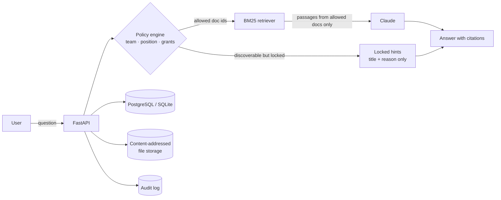

# VaultMind

**An AI document assistant that only answers from the files you're cleared to read.**

Employees ask in plain English ("I'm new, what should I read first?", "what's the SDE-2 salary band?"). VaultMind finds the right documents for their role, answers with numbered sources, and checks their **team** and **position** before it reads a single page on their behalf. If a matching document exists that they can't open, it says so and lets them request access from the people who own it.


| An intern asks about salary bands | The engineering manager asks the same thing |
|---|---|
|  |  |

The intern gets nothing from the salary sheet. It is never even sent to the model. Instead they see that it exists, why they can't open it, and a button to request access.

| Library in dark mode: locked files are sealed, with the reason | <kbd>Ctrl</kbd>+<kbd>K</kbd> command palette |
|---|---|
|  |  |

---

## Features

- **Permission-aware AI assistant.** Retrieval runs only over documents the user may open, so the language model never sees anything they aren't cleared for. Answers cite their sources, and conversations are saved.
- **Access by team and seniority.** Six positions (Intern → Executive) combine with four classifications (Public, Internal, Confidential, Restricted), plus sharing with other teams.
- **"Why can't I open this?"** Every decision comes with a plain-language reason, e.g. *"This document needs Manager level or above; you are Intern."*
- **Access requests with approvals.** Requests go to people with authority over that document: owning-team managers at or above its level, or directors for restricted files. Approved access is time-boxed and expires automatically, and it can be revoked.
- **Role-aware recommendations.** "Suggested for you" scores documents by team, role keywords, what colleagues are reading, and freshness, and shows the reasons behind each suggestion.
- **Sensitivity scanner on upload.** Detects PAN, Aadhaar, card numbers (with a Luhn check), API keys, passwords, salary and finance language, and contact details. It suggests a classification and blocks under-classified uploads unless the uploader explicitly overrides, which is logged. Auto-summaries are redacted.
- **Audit log and admin dashboard.** Logins, views, refused opens, downloads, assistant questions, uploads, approvals and role changes are all recorded.
- **Works without an API key.** With no key, an offline mode uses the same permission-filtered search and builds answers from the best-matching passages. With an Anthropic key, Claude writes the answers.
- **Command palette.** Press <kbd>Ctrl</kbd>/<kbd>⌘</kbd>+<kbd>K</kbd> anywhere to search every document you can see, jump to a page, or send a question straight to the assistant.
- **Light and dark themes.** Follows your system setting until you pick one, then remembers it, with no flash on load.
- **Built to be used, not just screenshotted.** Typing-style answers, a copy button, drag-and-drop upload, filter chips with live counts, search highlighting, loading skeletons, helpful empty and error states, keyboard shortcuts (<kbd>/</kbd> to search), and a skip link for keyboard users.
- **Demo company included.** Northwind Labs comes with 5 teams, 9 people across every position, and 20 realistic documents. One-click sign-in as each person lets you compare what they see.

---

## How access works

| Classification | Who can open it |
|---|---|
| **Public** | Everyone in the company |
| **Internal** | The owning team and teams it's shared with |
| **Confidential** | As internal, *and* at or above a minimum position (Manager by default) |
| **Restricted** | Only the uploader and people with an approved grant. Never shown to anyone else, not even as a title. |

Overrides, in order: admins see everything, uploaders keep access, an active grant opens a document, and executives see every non-restricted document company-wide.

All of this lives in one pure module, [`backend/app/policy.py`](backend/app/policy.py), with no database calls, so the rules are easy to read and unit-test.

## Architecture



### The security idea

Many "chat with your documents" apps put everything in the prompt and ask the model not to reveal it. That fails as soon as someone writes "ignore your instructions". VaultMind enforces access **before** retrieval:

1. The policy engine computes which documents this user may open.
2. The retriever scores passages **only from those documents**.
3. The model gets just those passages, wrapped as data, and is told to ignore any instructions inside them.
4. Any citation the model makes to a document outside its context is stripped.

A prompt-injection test checks this: an intern who claims to be the CEO and asks for the salary sheet gets a prompt that doesn't contain a single salary figure ([`tests/test_api.py`](backend/tests/test_api.py)).

### Design decisions

- **BM25 over embeddings.** It needs no model download or vector database, it's fast and explainable, and it's strong on the keyword-heavy queries people type when looking for a company file. It sits behind a small `add / remove / search` interface, so a hybrid or embedding retriever can replace it later.
- **Content-addressed storage.** Files are stored by SHA-256, so identical uploads share one blob and duplicates are detected. Moving to S3 means replacing three functions.
- **Discoverability is a per-document choice.** Showing a locked title helps people find the right owner, but restricted documents never leak even their existence. Unknown and undiscoverable documents both return `404`.

## Tech stack

**Backend:** Python 3.12, FastAPI, SQLAlchemy 2, PostgreSQL (SQLite for local runs), JWT auth with bcrypt, Anthropic API, pypdf
**Frontend:** React 18, TypeScript, Vite, React Router, with no UI framework
**Quality:** pytest (43 tests, run on SQLite and PostgreSQL in CI), a 224-check browser audit (Playwright + axe), Ruff, GitHub Actions, Docker

## Run it

### Quickest: Docker

```bash
cp .env.example .env            # optional: add VAULTMIND_ANTHROPIC_API_KEY
docker compose up --build
```

Open http://localhost:8000, click **Try the demo**, and pick a person to sign in as. Every demo password is `demo1234`.

### Local development

```bash
# API on :8000
cd backend
python -m venv .venv && source .venv/bin/activate
pip install -r requirements-dev.txt
uvicorn app.main:app --reload

# Web app on :5173 (proxies /api to :8000)
cd frontend
npm install
npm run dev
```

The first start creates a SQLite database and loads the demo company. Interactive API docs are at http://localhost:8000/docs.

### Tests

```bash
cd backend
pytest                 # 43 tests: policy rules, scanner, search, API flows, leakage checks
ruff check app tests
```

### Browser audit

[`e2e/audit.js`](e2e/audit.js) drives the real app in Chromium and checks **224 things**:

- Every flow as six different people: sign-in (including wrong passwords and a corrupted session), the assistant, citations, copy, conversations, the command palette, library search and filters, upload (drag-and-drop, unsupported and empty files, duplicates, the sensitivity override), downloads, access settings, delete with confirmation, approving, denying, cancelling and revoking requests, and the admin tools.
- Failure handling: the API going offline, a failed chat message (the draft is kept), and rate limiting.
- Every page at 360, 390, 768, 1024, 1280, 1440 and 1920 px, in light and dark: no horizontal overflow, readable headings, and touch targets of at least 24 px.
- An [axe](https://github.com/dequelabs/axe-core) WCAG 2 A/AA scan of every page, plus a check for any console error or failed request.

```bash
cd backend && rm -f vaultmind.db && uvicorn app.main:app      # fresh demo data, serving frontend/dist copied to backend/static
cd e2e && npm install && npx playwright install chromium && npm run audit
```

## Things to try

1. Sign in as **Aarav (Intern)** and ask *"What are the salary bands for SDE-2?"*, then sign in as **Rohan (Engineering Manager)** and ask the same.
2. As Aarav, ask *"How do we handle a production incident?"*. The runbook is locked to Associate and above, so request access.
3. As **Rohan**, open **Access requests** and approve it. Aarav can now open the runbook for the number of days you chose.
4. Upload a text file containing a PAN number and mark it **Public**. The scanner stops you.
5. Sign in as **Dev (Admin)** to see refused opens, assistant questions and the full activity log.

## Project structure

```
backend/
  app/
    policy.py        access rules: who can view, manage, approve (pure functions)
    assistant.py     permission-filtered retrieval + LLM / offline answers
    search.py        BM25 index over document chunks
    recommend.py     explainable, role-aware suggestions
    sensitivity.py   PII / secret scanner and redaction
    services.py      ingest pipeline: extract → scan → chunk → summarise → index
    routers/         auth, documents, assistant, access requests, admin
    seed.py          demo company
  tests/
frontend/
  src/pages/         Landing, Login, Assistant, Library, Document, Requests, Admin
  src/components/    Shell, CommandPalette, RichText, icons, shared bits (avatars, tags, dialogs)
  src/theme.tsx      light / dark theme
e2e/
  audit.js           browser audit: flows, breakpoints, accessibility
```

## What I'd build next

- Group and per-project permissions on top of teams
- Hybrid retrieval (BM25 + embeddings) with re-ranking
- Database migrations with Alembic, and a Redis-backed rate limiter for multiple instances
- SSO (Google Workspace / Okta) and syncing teams from an HR system
- Email or Slack notifications for access requests

## License

MIT
