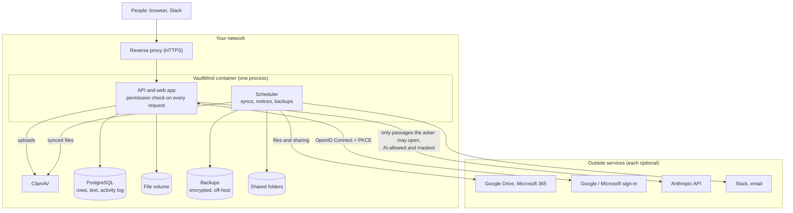

# Security overview

For security reviewers and IT teams evaluating VaultMind for a self-hosted pilot. It
describes how data moves, who can see what, how that's enforced and tested, and what isn't
covered yet. Each claim links to the code or test that backs it.

## How data moves

Data only leaves your network for the optional services you configure, and each is
switched on by an environment variable. The AI service receives only what the
[AI data policy](ai-data-policy.md) allows.

## Who can see what

Access is decided by one pure function, [`policy.can_view`](../backend/app/policy.py), from the
person's team, position (Intern to Executive), group memberships and grants, and the
document's classification, owning team, sharing and minimum position. Synced files can
instead follow the sharing they have in Google Drive or Microsoft 365. The decision runs on
the server for every request: listing, opening, downloading, searching, answering and acting.

- **Search can't be used to probe locked documents.** Content search runs only over documents the
  person can open; locked documents match on their titles alone, and restricted documents are
  never shown at all ([A3, A4](production-readiness.md#a-critical-security-and-data-loss-risks)).
- **The assistant can't leak them either.** Retrieval is limited to openable documents before any
  text is gathered, and citations the model makes up are removed. The
  [answer-quality benchmark](../backend/eval/) asks 229 questions as nine different people,
  including prompt injections and questions about files they can't open, and checks every
  answer for text, secret phrases, document ids or hints from documents the asker can't open:
  **0 leaks**, checked in CI on every change.
- **Filters only narrow.** Library and assistant filters (team, owner, date, source) apply after the
  permission check, never instead of it (`test_filters_never_widen_access`).
- **Every decision is explained** to the person ("needs Manager level or above; you are Intern") and
  recorded in the activity log.

## Accounts and sessions

| Area | How | Backed by |
|---|---|---|
| Passwords | bcrypt; at least 12 characters for operator and self-service changes; the same response and timing for unknown accounts | `test_login_gives_the_same_answer_for_unknown_accounts` |
| Guessing | 10 failures per account and 50 per address in 5 minutes | `test_login_is_rate_limited_per_account`, `…_per_address` |
| Company sign-in | OpenID Connect with PKCE, state and nonce in a signed HttpOnly cookie; ID-token signature, issuer, audience, expiry and nonce checked; allowed domains or tenant | `test_sso.py` |
| Sessions | Every sign-in is a server-side session (only a SHA-256 of its id is stored) checked on every request; ended by sign-out, password changes and resets, deactivation, removed admin rights, an administrator, or 120 idle minutes; 8 hours at most | `test_sessions.py` |
| MFA | Use company sign-in (Google or Microsoft enforce your MFA policy), and turn password sign-in off for everyone but administrators (`VAULTMIND_PASSWORD_LOGIN=false`) | |
| Secrets | Only in the server's environment, never in the database or the browser; production refuses to start with a weak or default signing secret | `test_production_refuses_a_missing_or_weak_secret` |

## Files

- **Malware**: every upload and synced file is scanned by ClamAV before it's parsed or stored; if
  the scanner can't scan, the file is refused ([operations](operations.md#malware-scanning)).
- **Parsing**: size limits while the body streams in, zip-bomb and page limits for Word and PDF files,
  and plain refusals for encrypted or damaged files.
- **Downloads** are always attachments, with an allow-listed content type, `nosniff` and a sanitised
  file name; nothing uploaded is ever rendered by the app.
- **Sensitivity scanner**: identity numbers, card numbers, secrets and salary language raise a
  document's suggested classification; under-classifying needs an explicit, logged override, and
  folder rules can't lower what the scanner found.

## The web app

A strict Content Security Policy (no inline scripts or styles, no third-party origins), fonts
served by the app itself, `X-Frame-Options: DENY`, `nosniff`, a referrer policy, a permissions
policy, COOP, and optional HSTS. API responses are `no-store`. Unknown API paths return JSON 404s.
Questions can't be sent on someone's behalf through a link.

## Records and monitoring

- **Activity log**: sign-ins and sign-outs, every document opened, downloaded, refused, uploaded,
  shared, changed and deleted, every access request and decision, every question asked, blocked
  malware, backups, and administrators' changes to people, with times and who did it. It is
  append-only in the app; anyone with direct database access can still change it (see the
  [roadmap](roadmap.md) for a tamper-evident log).
- **Request ids** in every response and log line; **Prometheus metrics** and
  [alert rules](../deploy/prometheus-alerts.yml) ([operations](operations.md#monitoring)).

## Data at rest and backups

VaultMind doesn't encrypt its own database or file volume: use encrypted disks or volumes for
PostgreSQL, the file volume and the backup folder. Backups contain every document and password
hash; they're written with `0600` permissions, checked by restoring them, and should be kept off
the host ([operations](operations.md#backups)).

## Supply chain and testing

- Pinned dependencies; `pip-audit` and `npm audit` run in CI and report 0 known vulnerabilities.
- On every change, CI runs the backend tests on SQLite and PostgreSQL, the answer-quality benchmark
  against its baseline, a browser audit of every flow in Chromium, Firefox and WebKit (with an axe
  accessibility scan), and the production Docker image with PostgreSQL, including a backup that's
  restored into a new database.
- A record of what was audited, fixed and not yet verified is in
  [production-readiness.md](production-readiness.md).

## Not covered yet

| Gap | Today | Planned |
|---|---|---|
| One process | Search index, rate limits and scheduler live in the app process; run one container | Shared index and Redis-backed limits ([roadmap](roadmap.md)) |
| Encryption at rest | Up to the operator's disks and volumes | Encrypted object storage for files |
| Tamper-evident activity log | Append-only in the app | Hash-chained log and export for auditors |
| Provisioning | Directory sync from Google or Microsoft, or spreadsheet import | SCIM |
| Self-service password reset | Administrators reset passwords | Email-based reset, or company sign-in only |
| Third-party penetration test | Not done | Before general availability |

## Reporting a vulnerability

Please report security problems privately, not in a public issue: use **Security → Report a
vulnerability** on the GitHub repository. (The repository owner has to turn this on once:
Settings → Code security → Private vulnerability reporting. Until then, ask the maintainer for a
private channel through GitHub without describing the problem publicly.) Include what you
found, how to reproduce it, and what it exposes.
